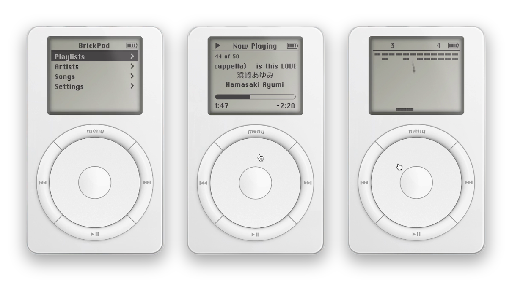
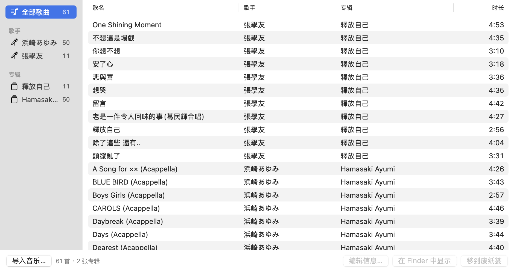

# BrickPod



Apple Music 网站的 404 页面（随便打开一个不存在的地址，比如
[music.apple.com/us/new/1122](https://music.apple.com/us/new/1122)）里藏着一个彩蛋：
一台能操作的初代 iPod，点控轮、像素屏幕、隐藏的打砖块都在。

BrickPod 把它搬到了 Mac 桌面上：窗口本身就是一台 iPod，悬浮在桌面上，可以导入自己的音乐来播放。

## 下载安装

1. 在 [Releases](https://github.com/norsizu/BrickPod/releases/latest) 下载 `BrickPod.zip`，解压
2. 把 BrickPod.app 拖进「应用程序」
3. 第一次打开会提示无法验证开发者（App 没有经过 Apple 公证）：
   右键 App →「打开」；macOS 15 及以上要到「系统设置 → 隐私与安全性」底部点「仍要打开」

支持 Apple 芯片和 Intel，需要 macOS 12 及以上。

## 使用

| | |
|---|---|
| 操作 iPod | 和真的一样：在点控轮上画圈滚动，中间键确认，MENU 返回 |
| 移动 | 按住机身任意位置拖动 |
| 关闭 | 鼠标移到 iPod 上，左上角会出现 ✕；或 ⌘Q |
| 导入音乐 | ⌘O，或把音乐文件拖到 iPod 上。支持 flac / mp3 / m4a / wav / aiff |
| 管理曲库 | ⌘L，见下图 |
| 更多 | 右键机身：切换大小、悬浮在最前、退出 |

**打砖块**：Settings → About，按住中间键 5 秒。转滚轮移动挡板，按中间键发球。

### 曲库管理



- 左栏按全部歌曲 / 歌手 / 专辑浏览，点表头排序
- 双击可以改歌名、歌手、专辑；多选后点「编辑信息…」批量修改
- 删除的歌会移到废纸篓
- 导入时会复制一份到 `~/Library/Application Support/BrickPod/`，原文件不动。
  换电脑时把这个文件夹一起拷过去，曲库就跟着走

## 自己编译

```bash
cd mac-app && ./build.sh
```

只需要 Xcode Command Line Tools，产物是 `mac-app/BrickPod.app` 和 `BrickPod.zip`。

## 版权

iPod 组件、字体和图片来自 Apple Music 网站，版权归 Apple 所有，本项目仅作个人学习和怀旧使用。
